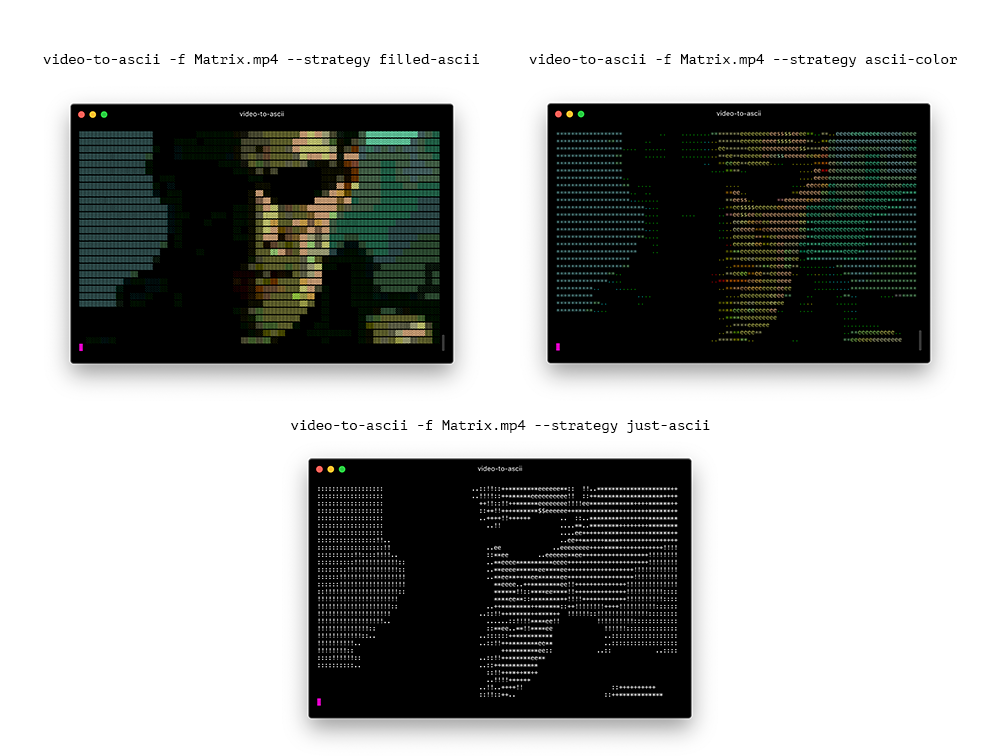
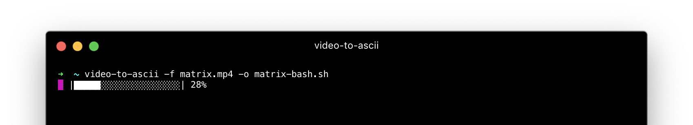
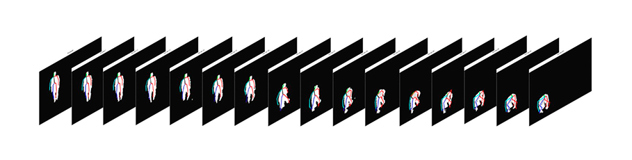
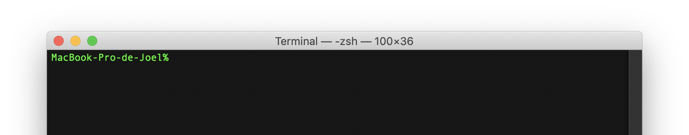
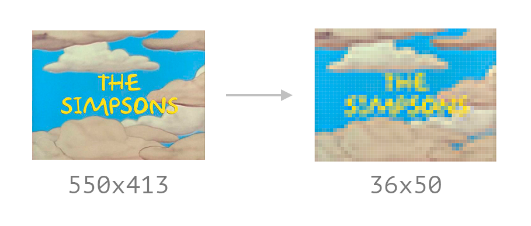
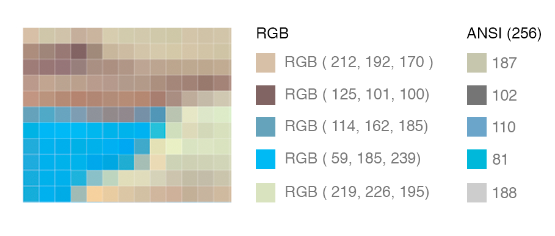
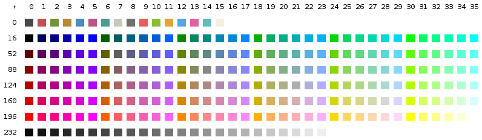
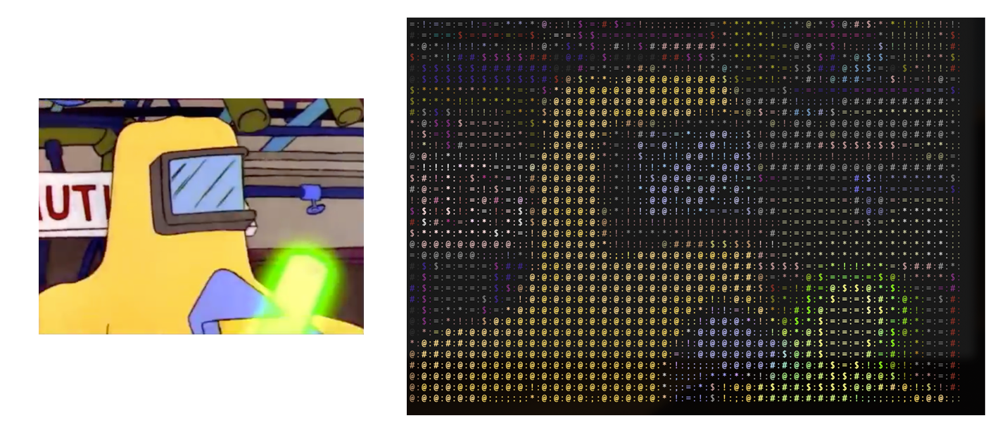

## Optional GPU acceleration

CPU remains the default. Select `--backend cuda` for NVIDIA or `--backend metal`
for Apple Silicon. `--backend mlx` remains an alias for `metal`. Install the
matching optional dependency with `pip install -e ".[cuda]"` or
`pip install -e ".[metal]"`; Apple acceleration needs Python 3.10+ on arm64 macOS.

```bash
video-to-ascii -f INPUT.MOV --backend cuda --strategy ascii-color -o OUTPUT.mp4
video-to-ascii -f INPUT.MOV --backend metal --strategy ascii-color -o OUTPUT.mp4
```

Ordinary CPU calls retain the existing pixel conversion, sizing, and text-export
behavior. Selecting `cuda`, `metal`, `mlx`, or `auto`, or using the new sizing
and frame-limit options, selects
the extended rendering pipeline. MP4 export uses that pipeline on every backend.

A shared player and export pipeline uses CPU, CUDA, or Metal frame renderers.
Decoding, rendering, and encoding are selected independently. `--backend auto`
tries the platform GPU and permits CPU fallback during initialization; explicit
GPU modes report failures. Failures after processing begins are reported rather
than silently restarting a partial conversion.

NVIDIA acceleration needs CUDA 12, CuPy, and FFmpeg with NVDEC, `scale_cuda`, and
NVENC. Set `CUDA_PATH` if the toolkit is outside `/usr/local/cuda`. A CUDA-enabled
OpenCV build is not required. Jetson can use CUDA rendering with CPU video I/O
through `auto`; its platform video codecs are not implemented by this backend.

Apple acceleration uses MLX/Metal rendering and FFmpeg VideoToolbox decoding and
standard H.264 encoding. Apple resizing and float64 saturation normalization stay
on CPU. Host memory connects the video and rendering stages. `--quality lossless`
uses NVENC on supported NVIDIA hardware and libx264 on CPU or Apple, preserving
the rendered YUV420 frames. MP4 retains displayed resolution and audio by default;
odd axes are padded by one pixel. Frame timing uses the average source rate.
`--columns`, `--rows`, and `--max-frames` support explicit sizing and short tests.
Shell and JSON outputs remain available. MP4 rendering needs a monospace font.

Run `python -m unittest discover -s tests -v`. Set
`VIDEO_TO_ASCII_TEST_CUDA=1` or `VIDEO_TO_ASCII_TEST_MLX=1` to include the shared
GPU rendering contract and full video integration tests on the matching hardware.

<div align=center>

  

<p>

  It's a simple python package to play videos in a terminal using [ASCII](https://en.wikipedia.org/wiki/ASCII) characters.

  [](https://opencollective.com/video-to-ascii) [](https://badge.fury.io/py/video-to-ascii)
  [](https://codeclimate.com/github/joelibaceta/video-to-ascii/maintainability)
  [](https://github.com/joelibaceta/video-to-ascii)

</p>


</div>

<details><summary><b>Translations</b></summary>
<p>

- [🇺🇸 English](./README.md)
- [🇪🇸 Español](./translations/README_es.md)
- [🇹🇼 繁體中文](./translations/README_zh-TW.md)

<p>
</details>

## Requirements

- Python3
- PortAudio (_Only required for installation with audio support_)
- FFmpeg (_Only required for installation with audio support_)
- Linux or MacOS ... for now

## Installation

### From PyPI (Recommended)

Standard installation (without audio support):

```bash
$ pip install video-to-ascii
```

With audio support:

```bash
$ pip install video-to-ascii[audio]
```

Complete installation (with all optional dependencies):

```bash
$ pip install video-to-ascii[all]
```

### 🔄 Migration Guide

If you were using the old installation method with `--install-option`:

```bash
# ❌ Old way (no longer supported)
$ pip install video-to-ascii --install-option="--with-audio"

# ✅ New way  
$ pip install video-to-ascii[audio]
```

**Note**: The `--install-option` flag has been [deprecated by pip](https://pip.pypa.io/en/stable/news/#deprecation-of-install-option-and-global-option) and removed in pip 23.1+.

### From Source

Clone the repository and install:

```bash
$ git clone https://github.com/joelibaceta/video-to-ascii.git
$ cd video-to-ascii
$ pip install .
```

Or with audio support:

```bash
$ pip install .[audio]
```

## How to use

Just run `video-to-ascii` in your terminal

```bash
$ video-to-ascii -f myvideo.mp4
```

### Options

**`--strategy`**
Allow to choose a strategy to render the output.



**`-o --output`**
Export the rendering output to a bash file to share with someone.



**`-a --with-audio`**
If an installation with audio support was made, you can use this option to play the audio track while rendering the video ascii characters.

## How it works

Every video is composed by a set of frames that are played at a certain frame rate.



Since a terminal has a specific number of rows and columns, we have to resize our video to adjust to the terminal size limitations.



To reach a correct visualization of an entire frame we need to adjust the _frame height_ to match the _terminal rows_, avoiding using more _characters_ than the number of _terminal columns_.



When picking a character to represent a pixel we need to measure the relevance of that pixel's color in the frame, based on that we can then select the most appropriate character based on the [relative luminance](https://en.wikipedia.org/wiki/Relative_luminance) in colorimetric spaces, using a simplified version of the luminosity function.

<p align="center">
  
</p>

> Green light contributes the most to the intensity perceived by humans, and blue light the least.

This function returns an integer in the range from 0 to 255, we assign a character according to density to show more colored surface for areas with more intense color (highest values).

```python
CHARS_LIGHT 	= [' ', ' ', '.', ':', '!', '+', '*', 'e', '$', '@', '8']
CHARS_COLOR 	= ['.', '*', 'e', 's', '@']
CHARS_FILLED    = ['░', '▒', '▓', '█']
```

The reduced range of colors supported by the terminal is a problem we need to account for. Modern terminals support up to 256 colors, so we need to find the closest 8 bit color that matches the original pixel in 16 or 24 bit color, we call this set of 256 colors [ANSI colors](https://stackoverflow.com/questions/4842424/list-of-ansi-color-escape-sequences).





Finally, when putting it all together, we will have an appropriate character for each pixel and a new color.



## Contributors

### Code Contributors

This project exists thanks to all the people who contribute. [[Contribute](./CONTRIBUTING.md)].

<a href="https://github.com/joelibaceta/video-to-ascii/graphs/contributors"></a>

### Financial Contributors

Become a financial contributor and help us sustain our community. [[Contribute](https://opencollective.com/video-to-ascii/contribute/)].

Or maybe just [buy me a coffee](https://ko-fi.com/joelibaceta).

#### Individuals

<a href="https://opencollective.com/video-to-ascii#backers" target="_blank" rel="noopener"></a>

#### Organizations

Support this project with your organization. Your logo will show up here with a link to your website. [[Contribute](https://opencollective.com/video-to-ascii/contribute)]

<a href="https://opencollective.com/video-to-ascii/organization/0/website" target="_blank" rel="noopener"></a>
<a href="https://opencollective.com/video-to-ascii/organization/1/website" target="_blank" rel="noopener"></a>
<a href="https://opencollective.com/video-to-ascii/organization/2/website" target="_blank" rel="noopener"></a>
<a href="https://opencollective.com/video-to-ascii/organization/3/website" target="_blank" rel="noopener"></a>
<a href="https://opencollective.com/video-to-ascii/organization/4/website" target="_blank" rel="noopener"></a>
<a href="https://opencollective.com/video-to-ascii/organization/5/website" target="_blank" rel="noopener"></a>
<a href="https://opencollective.com/video-to-ascii/organization/6/website" target="_blank" rel="noopener"></a>
<a href="https://opencollective.com/video-to-ascii/organization/7/website" target="_blank" rel="noopener"></a>
<a href="https://opencollective.com/video-to-ascii/organization/8/website" target="_blank" rel="noopener"></a>
<a href="https://opencollective.com/video-to-ascii/organization/9/website" target="_blank" rel="noopener"></a>

## As Seen On
<a href="https://www.producthunt.com/posts/video-to-ascii" target="_blank" rel="noopener"></a>
